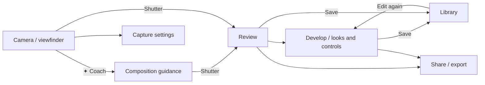

# iOS camera app: product plan and feature investigation

**Research checked:** 20 October 2026  
**Working concept name:** “Still” (placeholder; no naming decision implied)  
**Evidence labels:** **Documented** means stated in Framed’s public site, App Store listing, or linked privacy policy. **Proposed** means a product recommendation. Public pages describe features, but do not disclose every in-app screen, gesture, algorithm, or hardware limitation.

## Executive summary

Framed combines two jobs: it coaches composition before capture, then develops the captured image with editable film-inspired looks. Its camera-coach interaction is the distinctive part: scan a scene or draw a frame, receive directional framing advice, and wait for a live reticle/shutter-ready cue. Its editor is unusually broad for a camera-first product, covering RAW/ProRAW workflows, tonal and color controls, film effects, frames, and editable library history.

The recommended product should keep a familiar iPhone camera silhouette: a large live viewfinder, a few clear top controls, a large central shutter, a small recent-photo thumbnail, and advanced controls in a compact drawer. The differentiator should be a calmer, more transparent coach and a truly local-first editing workflow. Keep AI out of the camera's visual language: put the Apple Intelligence switch in Settings and show a plain, optional composition note only when requested. Build the camera and composition loop first, then bring the film lab to full parity.

## What the public sources document

The product website frames the flow as **Scan → Develop**. It says a sparkle button marks a suggested shot and tells the photographer where to move; film looks, grain, halation, and light leaks are chosen after capture. Its marketing images are described as showing the camera’s marked frame, a film-look selection screen, and a contact sheet. [Framed product site](https://shootframed.com/)

The site also claims “150,000+ Photographers”; treat that as a marketing claim, not an independently verified usage figure. The App Store listing is free with in-app purchases; the visible purchase entries vary by product/price tier, so confirm the target storefront before making a pricing comparison. [Framed product site](https://shootframed.com/) · [App Store listing](https://apps.apple.com/us/app/framed-take-aesthetic-photos/id6761207600)

The App Store description adds the more detailed interaction and feature inventory below. Its current page showed version 2.0.0 dated October 10, 2026 when checked. The older 1.3.0 release notes name four looks and explain the capture pipeline; those names are historical release-note detail, while the 2.0 description says new film presets without enumerating them. [Framed App Store listing](https://apps.apple.com/us/app/framed-take-aesthetic-photos/id6761207600)

### Source-grounded feature matrix

| Area | Publicly documented feature or interaction | Evidence / limits |
|---|---|---|
| Scene scan | Tap the ✦ scan control. Framed assesses light, subject, and composition, proposes a frame, and tells the user where to move. | The landing page explicitly describes tapping ✦; the App Store says it finds framing, zoom, exposure, and angle. The exact scoring model and feedback timing are not public. [Site](https://shootframed.com/) · [Listing](https://apps.apple.com/us/app/framed-take-aesthetic-photos/id6761207600) |
| User-created framing | Tap the viewfinder and draw a desired frame; Framed gives guidance toward it. | Documented in the App Store text; exact drawing gesture, handles, and persistence are unspecified. [Listing](https://apps.apple.com/us/app/framed-take-aesthetic-photos/id6761207600) |
| Adjusting a proposed frame | Move or resize the auto-generated or user-drawn frame before shooting. | Documented; exact hit targets and constraints are not shown in the text. [Listing](https://apps.apple.com/us/app/framed-take-aesthetic-photos/id6761207600) |
| Live subject guidance | A live reticle follows the subject; the shutter lights up when the photographer is lined up. The site says the suggested shot is marked and the app tells the user where to move. | Documented interaction outcome; supported subject types, tracking confidence, and alignment threshold are not specified. [Site](https://shootframed.com/) · [Listing](https://apps.apple.com/us/app/framed-take-aesthetic-photos/id6761207600) |
| Framing ratios | Capture compositions in 3:4, 4:5, 1:1, or 9:16. | Listed as shooting ratios. The listing does not say whether each ratio crops at capture, is a framing mask, or is applied during export. [Listing](https://apps.apple.com/us/app/framed-take-aesthetic-photos/id6761207600) |
| Focus and capture | The 1.3.0 notes say “true tap-to-focus” and a sharper full-sensor capture pipeline. | Release-note claims; no public image-quality benchmarks. [Listing / version history](https://apps.apple.com/us/app/framed-take-aesthetic-photos/id6761207600) |
| Manual camera controls | Manual shutter speed, ISO, flash control, and exposure compensation. | Listed in the current feature description. The exact ranges and model support are not given. [Listing](https://apps.apple.com/us/app/framed-take-aesthetic-photos/id6761207600) |
| RAW | RAW capture on iPhone Pro models; version 2.0.0 highlights ProRAW. | Hardware-dependent. Apple’s capture API exposes RAW/ProRAW only when the active device and session support it; the app must check at runtime. [Listing](https://apps.apple.com/us/app/framed-take-aesthetic-photos/id6761207600) · [Apple RAW/ProRAW guide](https://developer.apple.com/documentation/avfoundation/capturing-photos-in-raw-and-apple-proraw-formats) |
| Post-capture looks | Choose a film look after the shot and preview it on the actual photo before saving. Looks are starting points that can be adjusted. | Documented in the App Store description and 1.3.0 notes. Earlier notes name N1600, P400, RELIC, and MONO; do not assume those are the full 2.0 catalog. [Listing](https://apps.apple.com/us/app/framed-take-aesthetic-photos/id6761207600) |
| Light adjustments | Exposure, contrast, highlights, shadows, whites, blacks, fade, temperature, and tint. | Explicitly listed. [Listing](https://apps.apple.com/us/app/framed-take-aesthetic-photos/id6761207600) |
| Color adjustments | HSL mixer, color grading, curves, and calibration. | Explicitly listed. [Listing](https://apps.apple.com/us/app/framed-take-aesthetic-photos/id6761207600) |
| Film effects | Grain, halation, glow, light leaks, scratches, dust, motion, and vignette. | Explicitly listed. “Motion” is not further defined publicly. The website independently calls out grain, halation, and light leaks. [Site](https://shootframed.com/) · [Listing](https://apps.apple.com/us/app/framed-take-aesthetic-photos/id6761207600) |
| Borders and metadata | Plain, White, Paper, Black, Negative, and Specs frames; Specs prints the lens and capture settings. A date stamp is also offered. | Explicitly listed; exact frame dimensions, date formatting, and metadata fields are unspecified. [Listing](https://apps.apple.com/us/app/framed-take-aesthetic-photos/id6761207600) |
| Editable library | Framed keeps edits so the user can return and change them from the RAW. | Explicitly listed. Whether the RAW master is kept in the app sandbox, Photos, or both is not described. [Listing](https://apps.apple.com/us/app/framed-take-aesthetic-photos/id6761207600) |
| Import and sharing | Import from Photos, save to Camera Roll, and share directly to Instagram; the listing also describes an in-app gallery for review and sharing. | Explicitly listed. No public list of other share destinations. [Listing](https://apps.apple.com/us/app/framed-take-aesthetic-photos/id6761207600) |
| App availability | The listing says iPhone, with iOS 15.1 or later at the time checked; it also lists Apple-silicon Mac compatibility. | Store metadata can change. The planned app can set its own deployment target. [Listing](https://apps.apple.com/us/app/framed-take-aesthetic-photos/id6761207600) |

### Privacy note from the public materials

The App Store privacy label lists purchases as linked to the user and photos/videos plus device ID as not linked to the user; Apple says the developer supplies these answers and has not verified them. The linked policy, last updated March 30, 2026, says photos are captured on-device and not stored on the developer’s servers, but also says images may be sent to third-party AI processing in real time and are not retained. This is not enough to claim the coaching is entirely on-device. A competing product should make its processing path visible and default to on-device analysis where quality permits. [App Store privacy section](https://apps.apple.com/us/app/framed-take-aesthetic-photos/id6761207600) · [Framed privacy policy](https://shootframed.com/privacy.html)

## Recommended UI and interaction architecture

### Main capture screen

Keep the preview dominant. Use a dark, edge-to-edge viewfinder and a small, stable control set: flash and settings above; a minimal mode/ratio/zoom row near the bottom; a large shutter centered at the bottom; recent photo and camera switch to its sides. Make the default path usable without opening a menu.

Put **Coach** behind one obvious ✦ control. When active, show a restrained framing overlay and one short instruction at a time (“step back,” “raise the frame,” “wait for alignment”). Use a subtle ready-state change on the shutter and a haptic cue; let the user dismiss or mute coaching. Tap to focus and expose, then drag a nearby exposure slider. Pinch zoom and discreet lens stops remain familiar.

Manual capture controls (shutter, ISO, flash, exposure compensation) should live in a compact expandable tray. Ratio selection should use a short picker. Expose RAW/ProRAW only when supported, state the storage trade-off, and retain a processed preview for fast review.

### Review and develop

After capture, show the image immediately with a horizontal film-look rail. A second row can reveal **Light**, **Color**, **Effects**, and **Frame**. Keep beginner-friendly defaults visible, with detailed controls one level deeper. Include a hold-to-compare gesture, undo/redo, a clear “Save copy” action, and a persistent indicator for the RAW master and output format.

Store edits as a recipe over an immutable original. That enables returning to every edit, applying a recipe to another image, and exporting multiple versions without degrading the source.

### Library and settings

The recent thumbnail opens a simple internal grid with date/look filters and a clear route back to capture. The editor can be reopened from each asset. Settings should cover haptics, coach verbosity, save formats, RAW storage, ratio default, grid/level, and privacy. Ask for Photos permissions only when needed; allow capture and internal review before requesting broad library access.

### Navigation sketch

## Differentiating improvements to build on top

Everything in this section is a **proposal**, not a claim about Framed.

1. **Local-first coach.** Run horizon, subject, and composition analysis on-device by default. If a cloud model is ever offered, ask first and explain exactly what image data leaves the phone.
2. **Explain the suggestion.** Pair the frame with one reversible cue and a confidence level. For example, show the crop boundary and horizon correction before asking for movement; don’t present a subjective “best photo” as objective fact.
3. **Coach levels.** Offer Quiet, Guided, and Manual views so the same screen serves quick snapshots and deliberate shooting without turning the viewfinder into a control panel.
4. **Custom look recipes.** Let photographers save/share adjustable recipes, name them, compare against a neutral base, and apply them in batches. Preserve edits independently from the original.
5. **Smart capture safeguards.** Warn before high-storage RAW bursts, identify unsupported controls per device, and make capture readiness and save completion unmistakable.
6. **Accessibility and one-hand use.** Add VoiceOver descriptions, larger control targets, high-contrast overlays, reduced motion, haptics that can be disabled, and optional audio framing cues.
7. **Hardware entry points.** On supported iPhone models and OS versions, add Lock Screen camera launch and Camera Control support. Apple recommends keeping the live preview prominent and avoiding duplicated controls in the Camera Control overlay. [Apple Camera Control HIG](https://developer.apple.com/design/human-interface-guidelines/camera-control) · [Locked camera controls](https://developer.apple.com/design/human-interface-guidelines/controls)
8. **Optional on-device Apple Intelligence.** On supported devices, let people opt in to a short composition suggestion derived from coarse Vision measurements of the live preview. Check Foundation Models availability at runtime and explain when Apple Intelligence, the model, or the selected language is unavailable. Foundation Models requires iOS 26 or later; Vision-based composition guidance remains available on iOS 18+. The iPhone 17 Pro Max is listed as compatible, though compatibility alone does not guarantee the model is ready on a given device. [Apple Intelligence device list](https://www.apple.com/apple-intelligence/) · [Foundation Models availability](https://developer.apple.com/documentation/foundationmodels/systemlanguagemodel)

## Technical stack and architecture

| Layer | Recommendation | Why / caveat |
|---|---|---|
| App and UI | Swift 5 language mode, SwiftUI for screens and state, with a small UIKit bridge for `AVCaptureVideoPreviewLayer` and platform share controls. Set the minimum deployment target to iOS 18. | SwiftUI gives a native, adaptive interface; camera preview and session management still need AVFoundation integration. |
| Capture | AVFoundation: `AVCaptureSession`, `AVCapturePhotoOutput`, `AVCaptureDevice`, and a `AVCaptureVideoDataOutput` analysis stream. Isolate session configuration and device changes on a dedicated serial executor/actor. | Apple’s documented photo pipeline supports still capture, RAW, processed formats, and supported camera controls. Capability varies by device. [Session setup](https://developer.apple.com/documentation/avfoundation/setting-up-a-capture-session) · [Photo capture](https://developer.apple.com/documentation/avfoundation/capturing-still-and-live-photos) |
| Coach | Vision for horizon, rectangle, and tracking tasks; a small Core ML model plus composition heuristics for ranking candidate crops. Downsample and throttle preview analysis, and keep capture responsive. | Apple documents horizon/rectangle analysis and real-time object recognition. “Best composition” is product-specific: Apple APIs provide useful primitives, not a complete composition coach. [Vision overview](https://developer.apple.com/documentation/vision) · [Live object recognition](https://developer.apple.com/documentation/vision/recognizing-objects-in-live-capture) |
| Optional Apple Intelligence | Foundation Models for a user-requested, concise composition cue based on coarse Vision measurements; availability and language support checked at runtime, with an algorithmic fallback. | Vision and Foundation Models run on-device; the model receives only measurement text, not the photo. Foundation Models requires iOS 26+, while the camera and Vision guidance target iOS 18+. [SystemLanguageModel](https://developer.apple.com/documentation/foundationmodels/systemlanguagemodel) |
| RAW and editing | Core Image / `CIRAWFilter` for RAW rendering and a non-destructive filter graph; Metal kernels only where profiling shows a need. Store immutable source assets plus a versioned Codable edit recipe. | Core Image supports built-in/custom image processing and Metal-backed contexts; Apple documents RAW/ProRAW development. Large RAW files and export latency need measurement on real devices. [Core Image](https://developer.apple.com/documentation/coreimage) · [RAW/ProRAW](https://developer.apple.com/documentation/avfoundation/capturing-photos-in-raw-and-apple-proraw-formats) |
| Library and export | PhotosUI `PhotosPicker` for imports; PhotoKit for saving and metadata-aware asset creation; app-owned originals/recipes in Application Support; system share sheet for export. Request add-only Photos access for saves and read access only when the user imports/browses. | Apple provides least-privilege add-only access and a system picker. [Photos access](https://developer.apple.com/documentation/photos/phaccesslevel/addonly) · [PhotosPicker](https://developer.apple.com/documentation/photosui/photospicker) |
| Persistence | SwiftData for library metadata and edit-recipe records; files remain the source of truth for image data. | Keep database records small and make file writes atomic. Migrations must support evolving edit-recipe versions. |
| Monetization | StoreKit 2 only after a clear free/pro boundary is chosen; avoid blocking basic capture or exporting user-owned photos behind a subscription. | StoreKit 2 is Apple’s Swift-first API for purchase products and entitlements. [StoreKit 2](https://developer.apple.com/storekit/) |
| Privacy | On-device analysis as the default, no account required for camera use, clear permission prompts, opt-in diagnostics, and an explicit image-processing disclosure. | Framed’s own privacy policy describes third-party AI processing; use transparency and local processing as a product advantage, not merely a policy statement. |

### Important engineering constraints

- Use runtime capability checks for ProRAW, RAW formats, supported lenses, manual exposure/focus, and flash. Do not gate solely on a marketing model name. Apple’s RAW guide says the capture output exposes supported RAW formats and requires enabling ProRAW before capture begins. [Apple RAW/ProRAW guide](https://developer.apple.com/documentation/avfoundation/capturing-photos-in-raw-and-apple-proraw-formats)
- Manual shutter/ISO controls should reflect AVFoundation’s ranges and lock/configuration rules. Show unsupported controls as unavailable or hide them cleanly. [AVFoundation exposure controls](https://developer.apple.com/documentation/avfoundation/capture-device-exposure)
- A ratio overlay is not automatically a sensor-native ratio. Preserve the full sensor original and define whether the ratio is a crop recipe or destructive capture crop.
- Separate the low-latency camera preview from image development. Never run full-resolution RAW processing in the live analysis path.
- If adopting iOS 18+ camera extensions or Camera Control, keep a shared camera UI so launching from a hardware/Lock Screen entry point feels consistent. [Apple Camera Control integration](https://developer.apple.com/documentation/avfoundation/enhancing-your-app-experience-with-the-camera-control)

## Implementation roadmap

The durations below are planning estimates for a small team with two iOS engineers, a product designer, and access to an ML/image-processing engineer. Coaching quality and RAW performance are the largest unknowns; validate them early on physical devices.

| Phase | Scope | Exit criteria |
|---|---|---|
| 0. Product definition · 1–2 weeks | Choose deployment target and device matrix; define local/cloud privacy stance; settle ratio semantics, export formats, library ownership, and novice/pro control levels. Gather representative indoor, outdoor, low-light, and moving-subject scenes. | Signed-off interaction map, capture capability matrix, and coach quality rubric. |
| 1. Camera foundation · 2–3 weeks | Native viewfinder, permission states, tap focus/exposure, flash, lens/zoom, shutter, recent capture, standard HEIF/JPEG saving, Photos import/export shell. | Launch-to-preview and capture feel reliable; permissions and denied-access states are clear; baseline save survives app relaunch. |
| 2. Coach parity · 3–5 weeks | User-drawn frame and adjustment handles; ratio masks; horizon/subject observations; auto-composition candidate and one-step guidance; live reticle and ready state. | Users can complete scan → move/reframe → aligned capture; analysis never blocks shutter; fallback works with coach off or unsupported scenes. |
| 3. Develop lab · 3–5 weeks | Look engine, Light/Color/Effects controls, recipe serialization, before/after, frame/date stamp, RAW/ProRAW ingest and preview where supported. | Every slider round-trips from a saved recipe; source remains editable; export rendering matches the editor preview closely. |
| 4. Library and parity finish · 2–3 weeks | Internal library, import, save-to-Photos, share sheet, Specs metadata frame, error recovery, storage management, subscription decision. | A capture remains editable after relaunch; all public-listing workflows are represented; RAW+processed association is correct on supported hardware. |
| 5. Differentiation and release hardening · 2–4 weeks | Local-first coach settings, explainable cues, accessibility, Camera Control/Lock Screen entry points where supported, thermal/memory tuning, privacy copy, beta feedback. | Device compatibility, accessibility pass, privacy disclosures, and an agreed capture/edit performance budget. |

**Recommended first release boundary:** phases 1–3 with a focused subset of looks, manual frame drawing, auto coach v1, and a transparent format picker. Follow with full editor parity and library polish. Keep video out of the first release: neither Framed’s public feature list nor this concept requires it, and video would multiply capture, edit, and performance scope.

## Prototype and implementation handoff

- [Open the native iOS project setup](FramedCameraIOSStarter/README.md). The project uses SwiftUI, AVFoundation, Vision, PhotoKit, and XcodeGen; it includes a GitHub Actions workflow that produces an unsigned IPA artifact on a macOS runner. The source has not yet been built in this Windows workspace. The artifact needs provisioning/signing before a physical iPhone can install it.

## Sources

**Product sources**

- [Framed product website](https://shootframed.com/) — scan/develop narrative and marketing image descriptions.
- [Framed App Store listing](https://apps.apple.com/us/app/framed-take-aesthetic-photos/id6761207600) — feature list, user-created frames, live guidance, capture/editor controls, library, version notes, compatibility, and privacy label.
- [Framed privacy policy](https://shootframed.com/privacy.html) — camera/sensor processing, third-party AI, analytics, retention, and stated photo storage behavior.

**Apple implementation references**

- [Setting up a capture session](https://developer.apple.com/documentation/avfoundation/setting-up-a-capture-session)
- [Capturing still and Live Photos](https://developer.apple.com/documentation/avfoundation/capturing-still-and-live-photos)
- [Capturing photos in RAW and Apple ProRAW](https://developer.apple.com/documentation/avfoundation/capturing-photos-in-raw-and-apple-proraw-formats)
- [AVFoundation exposure controls](https://developer.apple.com/documentation/avfoundation/capture-device-exposure)
- [Vision framework](https://developer.apple.com/documentation/vision) and [recognizing objects in live capture](https://developer.apple.com/documentation/vision/recognizing-objects-in-live-capture)
- [Core Image](https://developer.apple.com/documentation/coreimage)
- [Photo library add-only access](https://developer.apple.com/documentation/photos/phaccesslevel/addonly) and [PhotosPicker](https://developer.apple.com/documentation/photosui/photospicker)
- [StoreKit 2](https://developer.apple.com/storekit/)
- [Camera Control Human Interface Guidelines](https://developer.apple.com/design/human-interface-guidelines/camera-control) and [controls / locked camera experiences](https://developer.apple.com/design/human-interface-guidelines/controls)
